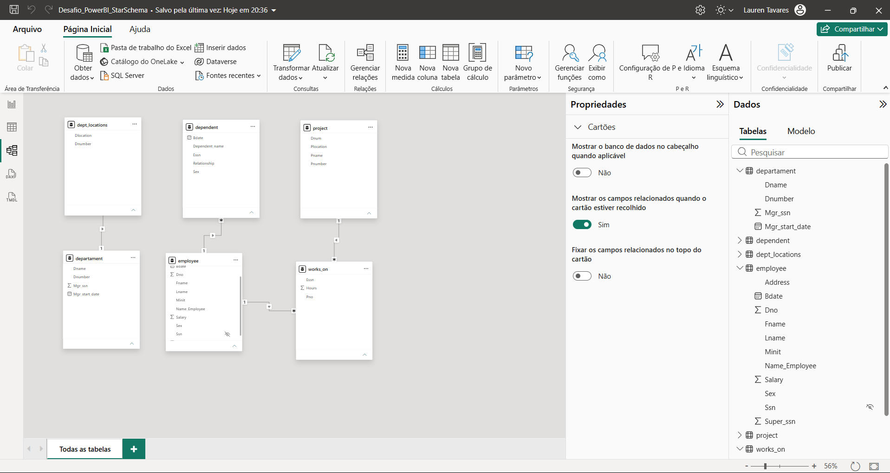

# Processamento e Modelagem de Dados com Power BI (Star Schema)

Projeto desenvolvido como parte do desafio prático da **DIO (Digital Innovation One)**, com o objetivo de transformar um conjunto de dados bruto e unificado numa arquitetura de dados em Estrela (*Star Schema*).

## 📌 Objetivos do Projeto
- Tratar, limpar e isolar tabelas a partir de uma fonte de dados única e concatenada utilizando o **Power Query**.
- Definir cabeçalhos adequados, remover linhas nulas/inválidas e ajustar tipos de dados.
- Construir o modelo relacional em estrela (*Star Schema*) com as cardinalidades corretas (1:N) e direção de filtro único.

## 📐 Arquitetura do Modelo (Star Schema)
O modelo foi estruturado separando os dados em tabela de facto e tabelas de dimensão:

- **Tabela Facto:**
  - `works_on`: Armazena o histórico de horas trabalhadas em cada projeto (`Essn`, `Pno`, `Hours`).
- **Tabelas de Dimensão:**
  - `employee`: Dados cadastrais dos funcionários (`Ssn`, nome, salário, departamento).
  - `departament`: Informações dos departamentos da empresa (`Dnumber`, `Dname`, gestor).
  - `project`: Detalhes dos projetos ativos (`Pnumber`, `Pname`, localização).
  - `dependent`: Informações dos dependentes dos funcionários (`Essn`, nome, parentesco).
  - `dept_locations`: Localizações associadas a cada departamento (`Dnumber`, `Dlocation`).

## 🛠️ Tecnologias Utilizadas
- **Power BI Desktop**
- **Power Query (Linguagem M)**

## 📸 Diagrama do Modelo de Dados

## 📁 Estrutura do Repositório
- `Desafio_PowerBI_StarSchema.pbix.pbix`: Ficheiro com a solução completa.
- `modelo_star_schema.png`: Imagem da vista de modelo finalizada.
- `README.md`: Documentação e explicação do projeto.
